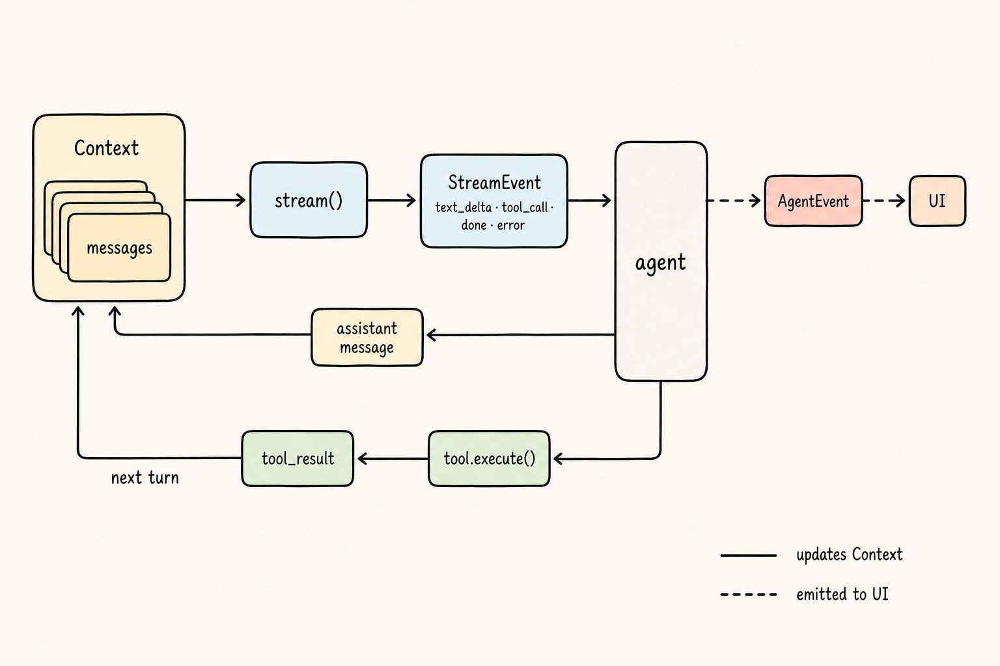

# 运行机制与接口

本文描述模型通信、消息结构、Agent 循环、工具执行、终端交互与会话持久化。模块职责和启动配置见[模块与配置参考](./architecture.md)。

## 数据模型

以下类型定义于 [llm.ts](../src/llm.ts)：

```typescript
type Model = {
  apiKey: string
  model: string
  baseUrl?: string
  maxTokens?: number
}

type ContentBlock =
  | { type: 'text'; text: string }
  | { type: 'tool_use'; id: string; name: string; input: unknown }
  | { type: 'tool_result'; tool_use_id: string; content: string }

type Message = {
  role: 'user' | 'assistant'
  content: string | ContentBlock[]
} | { role: 'system'; section: 'skills' | 'preferences' | 'knowledge'; content: string }

type Context = {
  systemPrompt?: string
  messages: Message[]
}

type ToolDef = {
  name: string
  description: string
  parameters: object
}
```

`Model.baseUrl` 未指定时使用 `https://api.openai.com/v1`。`maxTokens` 未指定时不发送 `max_tokens`，由 API 决定输出上限；CLI 显式设置为 `4096`。

`Context` 可直接序列化为 JSON。assistant 消息可同时包含文本与 `tool_use`；工具结果放在 user 消息的 `tool_result` 中，通过 `tool_use_id` 关联调用。`ToolDef` 仅包含提供给模型的工具描述，不包含执行函数。

以下是一次文件读取后的上下文示例：

```json
{
  "systemPrompt": "你是一个编码助手。",
  "messages": [
    { "role": "user", "content": "读一下 hello.txt" },
    { "role": "assistant", "content": [
      { "type": "text", "text": "我来读取这个文件。" },
      { "type": "tool_use", "id": "call_1", "name": "read_file", "input": { "path": "hello.txt" } }
    ] },
    { "role": "user", "content": [
      { "type": "tool_result", "tool_use_id": "call_1", "content": "hello world" }
    ] },
    { "role": "assistant", "content": [
      { "type": "text", "text": "文件内容是 hello world。" }
    ] }
  ]
}
```

## 模型通信

### stream 接口

```typescript
stream(
  model: Model,
  context: Context,
  opts?: { tools?: ToolDef[]; signal?: AbortSignal },
): AsyncGenerator<StreamEvent>
```

`stream()` 向 `${baseUrl}/chat/completions` 发送 POST 请求，使用 Bearer API 密钥认证，设置 `stream: true`。非空工具列表转换为 API 的 `function` 工具定义。

输出事件：

```typescript
type StreamEvent =
  | { type: 'text_delta'; delta: string }
  | { type: 'tool_call'; id: string; name: string; args: unknown }
  | { type: 'done'; stopReason: 'end_turn' | 'tool_use' | 'max_tokens' | 'aborted' }
  | { type: 'error'; error: Error }
```

文本片段即时输出；工具调用在响应流读完、参数组装完成后按索引顺序输出，随后发出 `done`。网络错误、非成功 HTTP 状态、缺失响应体或读取响应失败会产生 `error`；请求或读取期间的中断产生 `done`，其 `stopReason` 为 `aborted`。

### 消息格式转换

`contextToOpenAIMessages(context)` 返回供 API 使用的消息数组：

| 内部数据 | API 消息 |
| --- | --- |
| 非空 `systemPrompt` | 数组首部的 `role: 'system'` 消息 |
| 字符串 `content` | 保留原有 user、assistant 或 system 角色及消息位置 |
| assistant 中的 `text` | 合并到 assistant 的 `content` |
| assistant 中的 `tool_use` | 转换为 `tool_calls`，参数 JSON 序列化 |
| user 中的 `tool_result` | 拆为独立的 `role: 'tool'` 消息 |
| user 中的 `text` | 拆为独立的 `role: 'user'` 消息 |

assistant 仅有工具调用时，API 消息的 `content` 为 `null`；文本与工具调用均为空时，使用空字符串。

`buildAssistantMessage(text, toolCalls)` 将模型回复组装为一条 assistant 消息。`buildToolResultMessage(results)` 将 `{ tool_use_id, content }` 数组组装为一条包含工具结果的 user 消息。

### SSE 解析

响应字节经 `TextDecoder` 解码，缓冲区保留尚未形成完整行的内容。解析器处理以 `data: ` 开头的行，忽略 `[DONE]` 标记和无法解析为 JSON 的行，并读取 `choices[0]`。

`delta.content` 转为 `text_delta`。`delta.tool_calls` 按 `index` 缓存调用标识、名称和参数片段；参数片段在流结束后拼接并进行 JSON 解析。参数为空或解析失败时，当前实现使用 `{}`。

| API `finish_reason` | 内部 `stopReason` |
| --- | --- |
| `tool_calls` | `tool_use` |
| `length` | `max_tokens` |
| `stop` 或未提供专用映射 | 默认保持 `end_turn` |

## Agent 循环

接口定义于 [agent.ts](../src/agent.ts)：

```typescript
runAgent(
  model: Model,
  context: Context,
  tools: AgentTool[],
  signal?: AbortSignal,
): AsyncGenerator<AgentEvent>
```

调用方在启动前将用户输入追加到 `context.messages`。`runAgent()` 修改传入的上下文，并可能在压缩时替换其 `messages` 数组；它不负责会话文件读写。

### 事件协议

```typescript
type AgentEvent =
  | { type: 'assistant_text'; delta: string }
  | { type: 'tool_call'; id: string; name: string; args: unknown }
  | { type: 'tool_result'; id: string; name: string; result: string }
  | { type: 'step_end' }
  | { type: 'turn_end'; stopReason: 'end_turn' | 'max_tokens' | 'aborted' | 'error' }
```

`tool_call` 表示收到模型的调用请求，不表示工具已经执行成功。工具结果由 `tool_result` 提供；`step_end` 表示一轮模型回复及其全部工具结果已写入上下文，可保存完整批次；`turn_end` 表示本次 Agent 调用结束。`step_end` 不表示任务完成。

### 执行顺序

1. 检查上下文是否达到压缩阈值，必要时生成摘要。
2. 调用 `stream()`，收集模型文本与工具调用，同时输出 `assistant_text` 和 `tool_call`。
3. 将本次模型回复组装为 assistant 消息并写入上下文。
4. 若输出被截断且包含工具调用，生成错误结果写入上下文，输出 `step_end` 后进入下一次模型请求。
5. 若没有工具调用，输出 `turn_end` 并返回。
6. 按接收顺序串行执行工具，每次执行后输出 `tool_result`。
7. 将全部工具结果写为一条 user 消息，输出 `step_end`；CLI 等待本次保存完成后，进入下一次循环。

工具名称不存在或 `execute()` 抛出异常时，Agent 将 `error: ...` 字符串作为工具结果写入上下文，模型可据此继续处理。循环没有固定步数上限。



实线表示更新上下文的路径，虚线表示向消费端发送事件。界面显示不参与上下文更新。

### 结束与异常处理

| 情况 | 上下文处理 | 后续行为 |
| --- | --- | --- |
| 没有工具调用 | 保存 assistant 回复 | 以 `end_turn` 或 `max_tokens` 结束 |
| `tool_use` 但没有实际工具调用 | 保存 assistant 回复 | 按 `end_turn` 结束 |
| `max_tokens` 且有工具调用 | 保存调用，为每个调用补充参数可能不完整的错误结果 | 不执行这些工具，继续请求模型 |
| 模型请求中断 | 仅保存已收到的文本，丢弃未执行的工具调用 | 以 `aborted` 结束 |
| 模型请求失败 | 仅保存已收到的文本，向界面输出错误信息 | 以 `error` 结束，不自动重试 |
| 工具执行失败 | 保存错误字符串作为工具结果 | 继续循环 |
| 工具执行期间中断 | 保存已有结果，为未执行的调用补充 `error: aborted` | 携带已中断的 signal 进入下一次模型请求，由中断处理结束 |

输出截断时的工具错误结果格式为：

```text
error: output truncated by max_tokens, tool "<name>" args may be incomplete.
```

这些结果同时写入上下文并作为 `tool_result` 事件输出。后续重试仍可能被截断，当前没有独立的重试次数限制。

### 中断传播

CLI 为每次模型请求回合创建新的 `AbortController`，中断按下图传播。

```text
Ctrl+C → Tui.onAbort 回调 → controller.abort()
                            ↓
                          signal → runAgent → stream → fetch
                                            → tool.execute
```

`run_bash` 将 signal 传给命令执行；内置文件工具未使用 signal，已开始的读写操作不会由该信号取消。工具批次在每次执行后检查中断状态，并为跳过的调用补全结果，保持工具调用与结果配对。

## 上下文压缩

`compactContext()` 是 Agent 内部函数，在每次循环开始时调用，使用以下固定参数：

| 参数 | 值 | 行为 |
| --- | --- | --- |
| `COMPACT_THRESHOLD` | `50` | 消息数量达到 50 条时尝试压缩 |
| `KEEP_RECENT` | `20` | 保留最近 20 条消息 |

压缩时，将较早的聊天序列化为文本，使用同一模型发起不携带工具的摘要请求。旧消息中最后一份技能清单、长期偏好和知识索引按原顺序保留在摘要前面。非空摘要写为一条 user 消息，格式为 `[context summary]\n<摘要>`，其后保留最近 20 条消息。

signal 已中断、摘要请求报错或中断、摘要为空时，保留原始消息。当前实现按消息数量切分，不估算 token 数，也不调整工具调用与结果的切分边界；消息较长时仍可能超出模型上下文限制。摘要请求以 `max_tokens` 结束且已有文本时，当前实现仍会使用该文本。

## 内置工具

接口定义于 [agent.ts](../src/agent.ts)，实现位于 [tools.ts](../src/tools.ts)：

```typescript
type AgentTool = {
  name: string
  description: string
  parameters: object
  execute: (args: unknown, signal?: AbortSignal) => Promise<string>
}
```

`parameters` 为提供给模型的 JSON Schema。当前 Agent 不根据该 schema 校验参数，直接将模型输出传给 `execute()`。

`builtinTools()` 按下表顺序返回四个工具；除 `read_file` 的可选整数行范围外，表中参数均为必填字符串：

| 工具 | 参数 | 行为 |
| --- | --- | --- |
| `read_file` | `path`，可选 `offset`、`limit` | 默认以 UTF-8 读取并应用输出截断；指定行范围时从 `offset`（起点为 1）读最多 `limit` 行（1–200），返回总行数与下一段起点 |
| `write_file` | `path`、`content` | 递归创建父目录，覆盖写入 UTF-8 文件 |
| `edit` | `path`、`old_string`、`new_string` | 对唯一匹配的文本执行替换；个人记忆文件按行新增或替换偏好 |
| `run_bash` | `command` | 通过 Node.js `exec()` 执行 shell 命令 |

相对路径以进程工作目录为基准。工具没有额外的目录隔离或命令审批机制，使用当前进程的文件与命令执行权限。

### 文件写入与编辑

`write_file` 成功时返回 `wrote <path> (<length> chars)`，其中长度来自 JavaScript 字符串的 `length`。

`edit` 检查 `old_string` 的匹配数量：未找到或匹配多处时抛出错误，唯一匹配时写回替换后的文件。替换使用函数返回 `new_string`，使 `$&`、`$1` 等字符保留为字面值。成功结果为 `edited <path>: replaced <length> chars`。

个人 `~/.minipi/MEMORY.md` 通过 `edit` 维护，空 `old_string` 新增一条偏好，非空值须唯一匹配一整行。`write_file` 对这个路径返回工具错误，提示使用 `edit`。加载时机和失败处理见[跨会话记忆](./memory.md)。

个人知识目录中的主题页使用 `write_file` 新建、`edit` 更新，检查格式及旧内容后原子替换，再更新索引和变更日志。已存在的页面不能被不同内容整体覆盖，索引和日志不能直接编辑；部分完成逐项报告。`read_file`、`write_file`、`edit` 在工具边界校验参数。[知识库格式与失败恢复](./knowledge.md)

### 命令执行与输出截断

`run_bash` 的超时为 30 秒，`maxBuffer` 为 1 MiB。成功时返回 stdout；存在 stderr 时，将其与 stdout 分别标记后合并。命令失败时返回包含退出码、stderr 和 stdout 的字符串；signal 中断时返回 `aborted`。

未指定行范围的 `read_file` 和成功的 `run_bash` 输出超过 200 行时，仅返回最后 200 行，并将完整内容写入系统临时目录下的 `minipi-output-<pid>-<counter>.txt`。返回值首部包含总行数和完整输出路径。需要完整资料时用 `read_file` 的 `offset`、`limit` 补读；直接重读临时文件仍会触发默认截断。命令失败的返回分支不经过这一截断处理。

## 终端交互与 CLI

TUI 以 `> ` 为输入提示符，去除输入首尾空白，空输入不触发 Agent。CLI 在执行期间调用 `setBusy(true)`，完成后调用 `setBusy(false)` 恢复提示符，避免同时启动多个循环。

| Agent 事件 | TUI 方法 | 显示格式 |
| --- | --- | --- |
| `assistant_text` | `printText(delta)` | 直接写出文本片段 |
| `tool_call` | `printToolCall(name, args)` | `[tool: <name>] <JSON 参数>` |
| `tool_result` | `printToolResult(name, result)` | `[result: <name>] <结果>` |
| `step_end` | 无显示方法；CLI 保存会话 | 保存失败时输出警告并继续 |
| `turn_end` | `printTurnEnd()` | 换行 |

CLI 在 `max_tokens` 结束时额外显示 `[output truncated by max_tokens]`，在 `error` 结束时显示 `[error occurred]`。外层 `try/catch/finally` 将未处理的异常打印到终端，并确保恢复输入状态。

Ctrl+C 回调仅在 busy 状态下触发，同一回合只触发一次；空闲时由 readline 的默认行为处理。

## 会话持久化

[CLI](../src/cli.ts) 根据当前工作目录确定存储目录，再调用 [openSession(dir, resume)](../src/session.ts)。默认从空消息开始；续聊时按文件修改时间从新到旧查找，使用第一份含有效消息的文件。每行校验 `Message` 的角色、内容及内容块；空行、损坏行和结构不符的记录会跳过，磁盘读取错误则报告给用户。使用示例见[新开与继续会话](./sessions.md)。

会话使用 JSONL 格式，不保存 API 配置和 `systemPrompt`。第一次输入才创建文件。用户消息先落盘再调用模型；CLI 在每次 `step_end` 时等待 `session.save(context.messages)` 追加完整的回复和工具结果，整次 Agent 调用结束后再保存最终回复。单个 `tool_result` 事件发出时，结果可能尚未进入上下文，不能以它为保存边界。若 Agent 压缩时换了消息数组，则先完整写入临时文件，再替换当前会话文件；替换失败时旧文件仍在。

中途保存失败时报告警告并继续执行，下一次批次保存或最终保存会重试未保存的消息；最终保存失败由外层错误处理报告。恢复保证仅限成功保存的完整记录，不包括正在执行的批次和写入过程中强退。模型在续聊时利用记录继续，不保证不重读资料。行为和验收见[多步执行与进度恢复](./multi-step-execution.md)。

保存成功后才更新该会话的写入位置。同一会话按单进程使用；两个终端同时续聊同一个文件时，不协调它们的写入。
