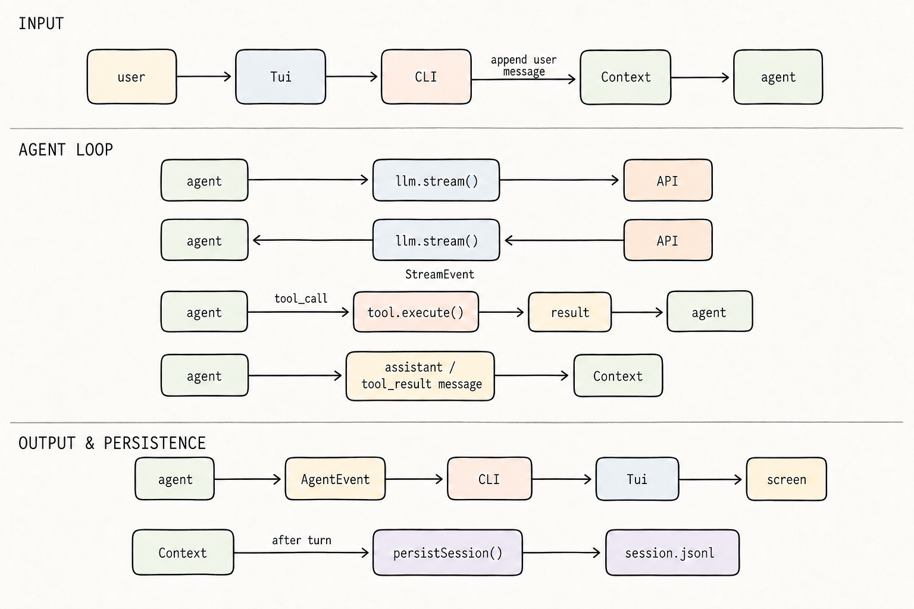
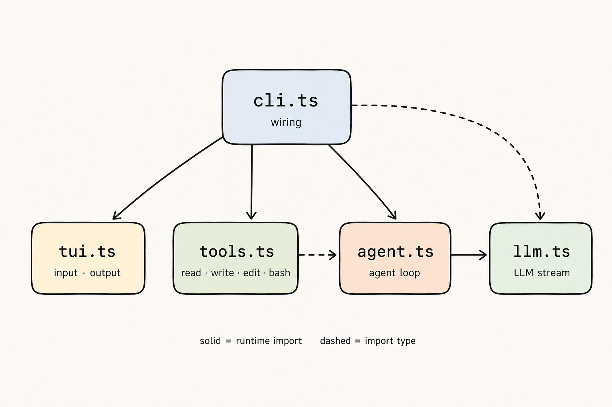
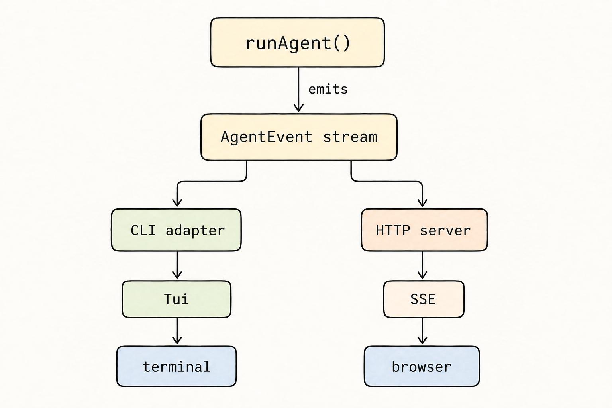

# 模块与配置参考

mini-pi 是使用 TypeScript 实现的命令行编码助手，支持 OpenAI 兼容的流式接口、工具调用、上下文压缩和本地会话恢复。数据结构、事件协议和异常处理见[运行机制与接口](./agent-runtime.md)。

## 运行与配置

使用 Node.js 22 或更高版本。安装依赖后，复制示例配置：

```sh
npm install
cp .env.example .env
```

编辑 `.env`，填写自己的 API 密钥、模型名称和接口地址，然后在项目根目录启动：

```sh
npm run dev
```

CLI 启动时自动加载当前工作目录中的 `.env`，`npm run dev` 和 `node dist/cli.js` 均适用。已经通过 `export` 设置的环境变量优先于 `.env`；没有 `.env` 时仍可使用环境变量启动。`.env` 已被 Git 忽略，不要提交真实密钥。

`MINIPI_MODEL` 和 `MINIPI_BASE_URL` 需要对应同一服务商提供的模型与接口。配置项如下：

| 环境变量 | 用途 | 默认值 |
| --- | --- | --- |
| `MINIPI_API_KEY` | API 密钥，必填；未设置时退出 | 无 |
| `MINIPI_MODEL` | 模型名称 | `deepseek-flash` |
| `MINIPI_BASE_URL` | OpenAI 兼容接口的基础地址 | `https://api.openai.com/v1` |

CLI 将 `maxTokens` 固定为 `4096`，请求地址为 `${baseUrl}/chat/completions`。默认模型名与默认接口地址不保证匹配，使用时应显式配置。

| 命令 | 用途 |
| --- | --- |
| `npm run dev` | 直接运行 `src/cli.ts` |
| `npm run build` | 将 TypeScript 编译到 `dist/` |
| `npm run typecheck` | 检查源码、测试和 Vitest 配置的类型，不生成文件 |
| `node dist/cli.js` | 运行编译后的 CLI |
| `npm test` | 执行自动化测试 |
| `node --env-file=.env --import tsx test/e2e.ts` | 从 `.env` 加载 API 配置并调用真实模型执行端到端测试 |
| `node --env-file=.env --import tsx test/knowledge-e2e.ts` | 用临时目录及真实模型验证知识整理、跨目录周报引用与无关问题 |


默认启动新会话，加 `-c` 或 `--continue` 可续聊当前工作目录最近的会话。文件位置和启动示例见[新开与继续会话](./sessions.md)。旧命名的环境变量和会话目录不会自动读取或迁移。

在 Git 仓库中输入“写本周周报”会用到内置技能。已打开的会话可用 `/reload` 发现新技能。[按需使用技能](./skills.md) · [刷新与提示缓存](./reload.md)

分享项目资料后，助手可整理为个人主题知识页，在其他工作目录的新会话中按需读取、引用。知识索引每回合自动刷新。[个人知识库](./knowledge.md)

## 模块职责

### llm.ts：模型接口适配

[源码](../src/llm.ts)

负责构造 HTTP 请求、转换消息格式、解析 SSE 响应和组装工具调用参数。输入为 `Model`、`Context` 和可选工具定义，输出为 `StreamEvent` 异步事件流。当前仅支持 OpenAI 兼容格式。

导出的类型包括 `Model`、`ContentBlock`、`Message`、`Context`、`StreamEvent` 和 `ToolDef`。

| 导出函数 | 用途 |
| --- | --- |
| `stream()` | 发起流式模型请求 |
| `contextToOpenAIMessages()` | 将内部上下文转换为 API 消息 |
| `buildAssistantMessage()` | 将文本和工具调用组装为 assistant 消息 |
| `buildToolResultMessage()` | 将工具结果组装为包含 `tool_result` 的 user 消息 |

`Context` 是可序列化的数据对象，由可选的 `systemPrompt` 和 `messages` 数组组成。模型适配层不执行工具，也不处理终端显示。

### agent.ts：Agent 循环

[源码](../src/agent.ts)

负责调用模型、串行执行工具、更新上下文和触发上下文压缩。模型返回工具调用时，执行结果写回上下文后继续请求；没有工具调用、发生请求错误或收到中断时结束。

导出 `runAgent()`、`AgentTool` 和 `AgentEvent`。`runAgent()` 修改传入的 `Context`，并输出 `assistant_text`、`tool_call`、`tool_result` 和 `turn_end` 四种事件。

`StreamEvent` 描述模型响应，`AgentEvent` 描述完整的 Agent 执行过程。消费端使用后者，无需处理原始 API 响应。

### tools.ts：内置工具

[源码](../src/tools.ts)

导出 `builtinTools()`，返回 `read_file`、`write_file`、`edit` 和 `run_bash` 四个 `AgentTool` 对象。工具接收参数并返回字符串结果，不直接读取或修改 `Context`。文件和命令操作具有外部副作用。

工具通过传给 `runAgent()` 的数组注册。新增或替换工具时，需要提供符合 `AgentTool` 的对象，无需修改循环逻辑。参数和执行行为见[内置工具](./agent-runtime.md#内置工具)。

### tui.ts：终端交互

[源码](../src/tui.ts)

导出 `Tui` 类，使用 Node.js `readline` 读取用户输入，通过标准输出显示文本、工具调用和结果，并提供 Ctrl+C 回调。CLI 负责将 `AgentEvent` 分发给对应的显示方法；`Tui` 本身不导入模型、工具或 Agent 模块。

| 方法 | 用途 |
| --- | --- |
| `onPrompt(cb)` | 注册非空用户输入回调 |
| `onAbort(cb)` | 注册运行期间的 Ctrl+C 回调 |
| `setBusy(busy)` | 设置运行状态，结束后恢复输入提示符 |
| `printText(delta)` | 输出文本片段 |
| `printToolCall(name, args)` | 输出工具名称与 JSON 参数 |
| `printToolResult(name, result)` | 输出工具结果 |
| `printTurnEnd()` | 输出回合结束换行 |
| `start()` / `stop()` | 启动输入或关闭 readline 并清理按键监听器 |

### cli.ts：应用入口与会话管理

[源码](../src/cli.ts)

负责读取配置、加载会话、创建工具与 TUI、接收用户输入、驱动 `runAgent()`，并将事件转发到终端。普通请求使用独立的 `AbortController`。回合结束后保存上下文，在 `finally` 中恢复输入状态。

CLI 只在直接运行时启动交互界面。[session.ts](../src/session.ts) 的 `openSession()` 选择会话文件、读取已有消息，并提供保存当前上下文的方法。

## 模块协作

一次用户请求的处理顺序：

1. TUI 将普通输入交给 CLI。CLI 依次追加有变化的技能清单、长期偏好和知识索引，再追加 user 消息，一同保存到会话文件。
2. Agent 调用 `stream()`，消费模型文本和工具调用事件。
3. Agent 将 assistant 消息写入上下文；存在工具调用时，串行执行并写入结果，再发起下一次模型请求。
4. CLI 将 `AgentEvent` 转发到 TUI。
5. Agent 结束后，CLI 保存会话并恢复输入。



运行时依赖从 CLI 指向 TUI、工具和 Agent，Agent 依赖模型适配层。`tools.ts` 对 `AgentTool`、`cli.ts` 对模型类型的引用属于类型依赖。



`AgentEvent` 也可由其他消费端处理。下图的 HTTP/SSE 分支表示接入方式，仓库当前提供的是 CLI/TUI 实现。


